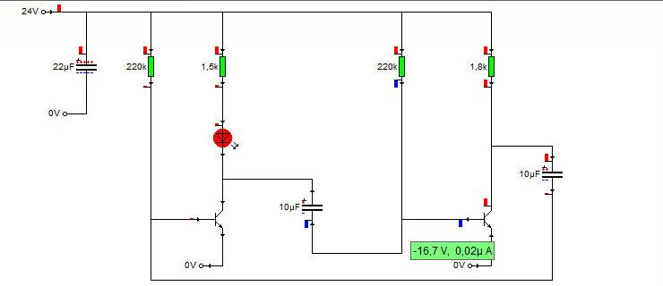

# crocodile-mcp

**MCP server that reads and generates Crocodile Physics 1.7 circuits (`.cyp`) with no GUI.**

Crocodile Physics is educational simulation software that is still used in French schools
(Bac Pro CIEL, STI2D…). It has no API and its file format is not documented. This project
decodes the `.cyp` format byte by byte (see [FORMAT.md](FORMAT.md)) and exposes it through
the [Model Context Protocol](https://modelcontextprotocol.io). An AI assistant can then:

- **read** a student's circuit: components, values, electrical nodes, voltages and currents
  saved at the last simulation, destroyed components;
- **generate** a complete circuit that Crocodile opens and simulates directly;
- **reset** a simulation (voltages, currents, capacitor charges).

Tested with Crocodile Physics 1.7 FR (Etendu), Build 613FR, on Windows.



## Installation

```bash
git clone https://github.com/aaldersondev/crocodile-mcp
cd crocodile-mcp
pip install .
```

The `crocodile_mcp.cyp` library itself only uses the Python standard library. The server
needs the `mcp` package.

## Configuring an MCP client

Claude Desktop (`claude_desktop_config.json`), Claude Code or any MCP client:

```json
{
  "mcpServers": {
    "crocodile-physics": {
      "command": "crocodile-mcp"
    }
  }
}
```

Without installing: `"command": "python", "args": ["-m", "crocodile_mcp.server"]`, with `cwd`
set to the repository folder.

## Tools

| Tool | What it does |
|---|---|
| `list_component_types` | supported types, pin names, sizes, units |
| `pin_positions` | coordinates of pin ends for a placed component |
| `create_circuit` | writes a new `.cyp` |
| `read_circuit` | decodes a `.cyp` (components, wires, nodes, saved state) |
| `reset_state` | zeroes saved voltages, currents and charges |

### Example: LED + resistor

```json
{
  "path": "C:/Users/me/Documents/led.cyp",
  "components": [
    {"id": "V", "type": "VoltRail", "x": 100, "y": 96,  "value": 9},
    {"id": "R", "type": "Resistor", "x": 200, "y": 150, "value": 470},
    {"id": "D", "type": "LED",      "x": 192, "y": 240},
    {"id": "G", "type": "VZero",    "x": 100, "y": 340}
  ],
  "wires": [
    {"from": "V.out",     "to": "R.top"},
    {"from": "R.bottom",  "to": "D.anode"},
    {"from": "D.cathode", "to": "G.out"}
  ]
}
```

- `(x, y)` is the top-left corner of the component body, in canvas pixels.
- A wire is either `{"from", "to"}` (routed vertically first, then horizontally) or
  `{"points": [[x, y], ...]}` (a polyline with only horizontal or vertical segments). Ends
  must land exactly on a pin end or on another wire end. `create_circuit` reports any wire
  ends that touch nothing.
- Supported components: `Resistor` (Ω), `ECapacitor` (F, plus optional `initial_voltage`),
  `LED`, `NPN` (value = hFE), `VoltRail` (V), `VZero` (0 V).

### Python library

```python
from crocodile_mcp import create_circuit, read_circuit
print(read_circuit("Simulation1.cyp")["nodes"])
```

`examples/` holds `led.py` and `astable.py` (a 24 V two-transistor astable multivibrator, T ≈ 3 s),
along with the files they generate.

## Practical tips

- **Electrolytic capacitors in an oscillator**: give them an `initial_voltage` that matches a
  state the circuit really reaches. Starting every capacitor at 0 V can make Crocodile
  reverse-bias one of them past about 3 V at the first time step, and the component
  "explodes" (see `examples/astable.py`).
- For an NPN switching an LED, an hFE of about 250 guarantees saturation. With 100, the
  default, some astables stay stuck.

## Tests

```bash
pip install .[test]
pytest
```

The main test rebuilds, through the API, a circuit drawn by hand in Crocodile
(`tests/data/lumiere_gui.cyp`). It checks that the structure, the electrical nodes and the
link table are identical to the original file.

## Limitations

- Crocodile Physics 1.7 only; other versions have not been tested.
- A small set of decoded components. Adding one = save a small circuit containing it from
  the GUI, then extract its template (`templates.json`).
- No probes or graphs in generated files (the `PROBES` section is left empty).

## License

MIT. Crocodile Physics and Crocodile Clips are trademarks of their owners. This project is
independent and contains no code or files from the software.
